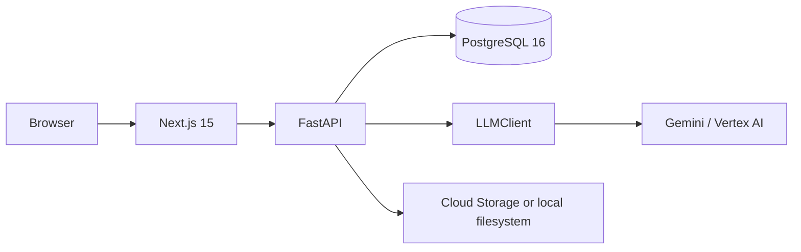

# Skincare Ingredient Advisor

A full-stack GenAI web app for analysing skincare ingredient lists, explaining catalogue ingredients, flagging likely irritants for a selected skin type, and checking routine conflicts.

> **Important:** The ingredient catalogue and conflict rules are illustrative. This app is not medical or dermatological advice.

## Architecture



## Local run

Requirements: Docker with Compose.

```bash
cp .env.example .env
docker compose up --build
```

Open `http://localhost:3000`. API docs are at `http://localhost:8000/docs`.

The default local provider is a deterministic fake, so no GCP account or API key is required.

## GenAI validation and fallback

`LLMClient` isolates Vertex AI from the application. Vertex responses are requested as JSON and validated with Pydantic. If the response is invalid or the provider fails, the deterministic rule-based result is returned with `ai_status: fallback`.

Only ingredient text or an uploaded label image is sent to the configured model. The API caps ingredient count and label uploads.

## API overview

- `POST /analyses` — parse and analyse an ingredient list.
- `GET /analyses/{id}` — retrieve an analysis.
- `GET/POST/DELETE /products` — product catalogue operations.
- `GET/POST/DELETE /routines` — routines.
- `POST /routines/{id}/items` — add a product to a routine.
- `GET /routines/{id}/conflicts` — data-driven conflict detection.
- `POST /labels` — local label upload stub.

## Tests

API tests use the fake LLM. CI is configured for pytest, Ruff, mypy, Vitest/React Testing Library, and Playwright. Exact test counts and coverage must be taken from an actual run; this repository does not fabricate them.

## GCP deployment

The build environment used to create this repository did **not** have Docker or an active `gcloud auth` account, so no GCP deployment was performed. Terraform and the GitHub Actions workflow are included for deployment once credentials/project variables are configured.

GitHub Actions uses Workload Identity Federation rather than service-account JSON keys. Configure repository variables for `GCP_PROJECT_ID`, `GCP_REGION`, `GCP_WORKLOAD_IDENTITY_PROVIDER`, and `GCP_DEPLOY_SERVICE_ACCOUNT`.

## Teardown

For Terraform-managed infrastructure:

```bash
cd infra
terraform destroy -var='project_id=YOUR_PROJECT_ID'
```

Review resources before destroying them, especially the Cloud SQL instance and storage bucket.

## Known limits

- The seeded catalogue is illustrative, not a medical-grade ingredient database.
- Local image upload stores bytes in a filesystem bucket stub; production should use signed Cloud Storage URLs and the configured Vertex image flow.
- Authentication/user ownership is intentionally outside this initial build.
- The repository contains no real production metrics.
