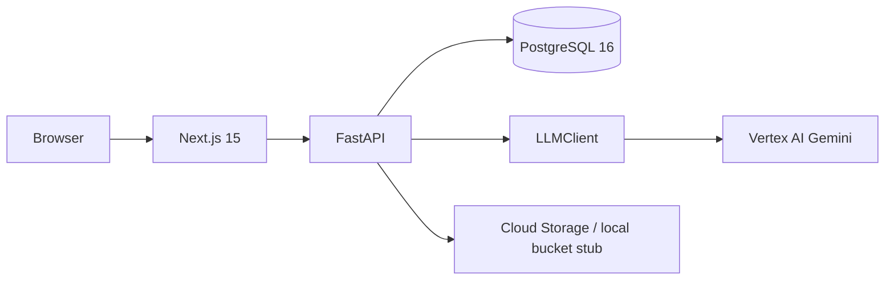

# Architecture

## Request flow
1. The browser submits an ingredient list and skin type.
2. FastAPI normalises and resolves catalogue names/aliases without dropping unmatched entries.
3. The injectable LLM client returns structured ingredient explanations. The response is Pydantic-validated.
4. Invalid AI output or an unavailable provider falls back to deterministic rule-based output and records `ai_status: fallback`.
5. Analyses, products, and routines are persisted in PostgreSQL.

## Data model
`products` and `ingredients` are many-to-many through `product_ingredients`, which stores ingredient order. `routines` contain `routine_items`, which point to products and a morning/evening slot.

## Trade-offs
- PostgreSQL keeps relational routine/product queries simple and supports `pg_trgm` for catalogue matching.
- Cloud Run avoids managing servers and keeps API/web services independently deployable.
- The local filesystem bucket stub makes development possible without a GCP account.
- Conflict rules are data-driven by ingredient function pairs, but the catalogue is illustrative and not medical advice.
